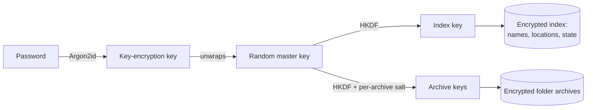

<p align="center">
  
</p>

<h1 align="center">Veilfold</h1>

<p align="center">
  <strong>Hide and lock private folders on shared computers.</strong><br>
  Encrypted or instantly hidden, behind a password — on macOS, Windows and Linux.
</p>

<p align="center">
  <a href="https://github.com/shenyizg/veilfold/actions/workflows/ci.yml"></a>
  <a href="https://github.com/shenyizg/veilfold/releases"></a>
  <a href="LICENSE"></a>
  
</p>

<p align="center">
  <b>English</b> · <a href="README.zh-CN.md">简体中文</a>
</p>

<p align="center">
  <picture>
    <source media="(prefers-color-scheme: dark)" srcset="docs/images/dark.png">
    
  </picture>
</p>

---

On a family laptop, a shared office PC or a lab machine, anyone who sits down can browse everyone's files.
Veilfold makes the folders you choose **disappear from their place in the file system** until you unlock
them with your password. It is similar in spirit to tools like *Secret Folder* or *Folder Lock*, but it is
free, open source, cross-platform and built on real, modern cryptography.

## Features

- **Two protection modes, chosen per folder**
  - **Encrypt** — contents *and* file names are encrypted into a single opaque archive. Nobody can read
    them without your password, not even with administrator rights or the disk in their hands.
  - **Hide** — the folder is moved into a concealed store on the same drive in an instant, regardless of
    its size. Ideal for huge folders when keeping out casual snoopers is enough.
- **Really gone, not just "hidden"** — a locked folder no longer exists at its location. It does not show
  up in Finder, Explorer, `ls -a`, `dir /a`, search or Spotlight.
- **Several people, one computer** — every password opens its *own* vault. Vaults cannot see each other,
  and the names and locations of protected folders are encrypted.
- **Recovery key** — an optional, printable key gets you back in if you forget the password.
- **Crash-safe by design** — every step is journaled in the encrypted index; an interrupted lock or unlock
  is completed or rolled back the next time the vault opens. Plaintext is deleted only after the encrypted
  copy has been written, flushed to disk and verified by decrypting it.
- **Desktop app for macOS and Windows**, a scriptable **command-line tool for all three platforms**.
- **Private by design** — no accounts, no network access, no telemetry. Just your files and your password.

<p align="center">
  
</p>

## Encrypt or hide?

|                                                    | Encrypt                                   | Hide                                  |
| -------------------------------------------------- | ----------------------------------------- | ------------------------------------- |
| Locking and unlocking                              | Proportional to size (hundreds of MB/s on an SSD) | Instant, any size             |
| Extra disk space while locking                     | About the size of the folder              | None                                  |
| Unreadable to someone browsing the computer        | ✅                                        | ✅                                    |
| Unreadable with admin rights or physical disk access | ✅                                      | ❌ (concealed, not encrypted)         |
| File names hidden                                  | ✅ encrypted                              | ✅ moved under a random name          |
| Preserves every byte of metadata                   | Contents, names, permissions, times, extended attributes | Everything (it is a plain move) |

Use **encrypt** for anything sensitive and **hide** for large media folders where speed matters more.
You can switch a folder's mode whenever it is unlocked.

## Install

### Download a release

Grab the latest build from the [releases page](https://github.com/shenyizg/veilfold/releases):

| Platform | Desktop app | Command line |
| -------- | ----------- | ------------ |
| macOS 13+ (Apple silicon and Intel) | `Veilfold_<version>_macos_universal.zip` | `veilfold_<version>_darwin_<arch>.tar.gz` |
| Windows 10/11 (x64) | `Veilfold_<version>_windows_amd64.zip` | `veilfold_<version>_windows_<arch>.zip` |
| Linux (x64, arm64) | — (build from source, experimental) | `veilfold_<version>_linux_<arch>.tar.gz` |

> [!NOTE]
> Release builds are not yet code-signed. On macOS, right-click **Veilfold.app → Open** the first time.
> On Windows, choose **More info → Run anyway** in the SmartScreen dialog.

### Build from source

You need [Go 1.26+](https://go.dev/dl/). The desktop app additionally needs the Xcode Command Line Tools
on macOS (`xcode-select --install`); on Windows nothing else is required.

```sh
git clone https://github.com/shenyizg/veilfold.git
cd veilfold
make build   # command-line tool  -> bin/veilfold
make gui     # desktop app        -> gui/build/bin/
```

Or install just the command-line tool: `go install github.com/shenyizg/veilfold/cmd/veilfold@latest`.
See [docs/building.md](docs/building.md) for details, including Linux and cross-compilation.

## Quick start

### Desktop app

1. Open Veilfold and choose a password. Save the **recovery key** it shows you.
2. Click **Add folder** (or drop a folder onto the window), choose **Encrypt** or **Hide**, and click **Protect**.
3. The folder vanishes from its location. Click **Unlock** to bring it back, and **Lock all** before you
   leave the computer. Optionally enable **auto-lock** in the settings.

### Command line

```console
$ veilfold init                          # create your vault
$ veilfold add ~/Documents/Taxes         # protect (and lock) a folder
Locked   /Users/alice/Documents/Taxes (encrypted, 412 files, 1.2 GB)
$ veilfold add --mode hide ~/Movies/Raw  # instant hiding for a large folder
$ veilfold list
ID        STATE   MODE     SIZE    PATH
3f2a9c1b  locked  encrypt  1.2 GB  /Users/alice/Documents/Taxes
8d01e7aa  locked  hide     -       /Users/alice/Movies/Raw
$ veilfold unlock taxes                  # by name, path or ID prefix
$ veilfold lock --all
```

Every command is documented in [docs/cli.md](docs/cli.md). For scripts, `--password-stdin` reads
passwords from standard input.

## How it works



- A vault is a random 256-bit **master key**, wrapped by a key derived from your password with
  **Argon2id** (64 MiB, 3 passes, 4 lanes) and optionally by a 128-bit **recovery key**.
- The **index** of protected folders is encrypted with **XChaCha20-Poly1305**.
- In encrypt mode a folder becomes one archive, encrypted with **ChaCha20-Poly1305** in the
  [STREAM](https://eprint.iacr.org/2015/189) construction (64 KiB chunks, as in
  [age](https://age-encryption.org)), so truncation, reordering and tampering are all detected.
- Locked folders live in a **store** on the same drive: inside Veilfold's data directory for your system
  drive, or in a hidden `.veilfold` directory at the root of other drives.

Read more in [docs/architecture.md](docs/architecture.md), [docs/security-model.md](docs/security-model.md)
and [docs/file-formats.md](docs/file-formats.md).

## Security model in short

Veilfold protects your folders from **other people using the same computer** — including, in encrypt
mode, people with administrator rights or physical access to the disk while the folders are locked.

It does **not** protect against malware or keyloggers running on the computer, against someone watching
you type your password, or against anyone while a folder is unlocked. Deleted plaintext can survive on
SSDs and journaling or copy-on-write file systems, so combine Veilfold with full-disk encryption
(FileVault, BitLocker, LUKS) for the strongest protection. Hide mode conceals; it does not encrypt.

Found a vulnerability? Please report it privately — see [SECURITY.md](SECURITY.md).

## Where is my data?

| | Data directory (vaults and the default store) |
| --- | --- |
| macOS | `~/Library/Application Support/Veilfold` |
| Windows | `%LOCALAPPDATA%\Veilfold` |
| Linux | `$XDG_DATA_HOME/veilfold` (default `~/.local/share/veilfold`) |

Folders on other drives are stored in `<drive root>/.veilfold/<user>/` (`.veilfold.noindex` on macOS) so
that locking never has to copy data across drives. Set `VEILFOLD_DATA_DIR` or pass `--data-dir` to use a
different data directory. `veilfold info` prints the locations in use.

## FAQ

<details>
<summary><b>I forgot my password. Can I get my folders back?</b></summary>

Yes, if you saved the recovery key: use **Forgot password?** in the app or `veilfold recover`. Without the
password and the recovery key, encrypted folders cannot be recovered by anyone — that is the point.
Hidden (not encrypted) folders are still on disk in the store and can be found manually.
</details>

<details>
<summary><b>Can other people tell that I use Veilfold?</b></summary>

They can see that Veilfold is installed and how many vaults exist. They cannot see which folders a vault
protects, what they are called or where they were, and encrypted contents are unreadable.
</details>

<details>
<summary><b>What happens if the computer crashes or loses power while locking?</b></summary>

Nothing is lost. Each step is recorded before it happens, and the original data is only removed after a
verified copy exists. The next time you open the vault, Veilfold finishes or undoes the interrupted
operation and tells you what it did.
</details>

<details>
<summary><b>Can I protect folders that are synced by iCloud Drive, OneDrive or Dropbox?</b></summary>

It works, but is rarely what you want: while the folder is locked, the sync service sees it as deleted and
may remove it from your other devices. Veilfold warns you when a folder looks cloud-synced.
</details>

<details>
<summary><b>Does it work for folders on external drives?</b></summary>

Yes. Veilfold keeps the locked data on the same drive, so the drive must be connected to unlock the folder.
</details>

## Project layout

```text
cmd/veilfold/      command-line entry point
internal/core/     vaults, locking, unlocking and crash recovery
internal/seal/     key derivation, authenticated encryption, recovery keys
internal/pack/     folder <-> archive serialization
internal/fsx/      platform specifics (volumes, locks, concealment)
internal/cli/      command-line interface
gui/               desktop app (Wails; separate Go module)
docs/              design and user documentation
scripts/           maintenance scripts (icon generation)
```

## License

Veilfold is released under the [MIT License](LICENSE).
