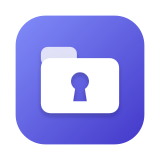
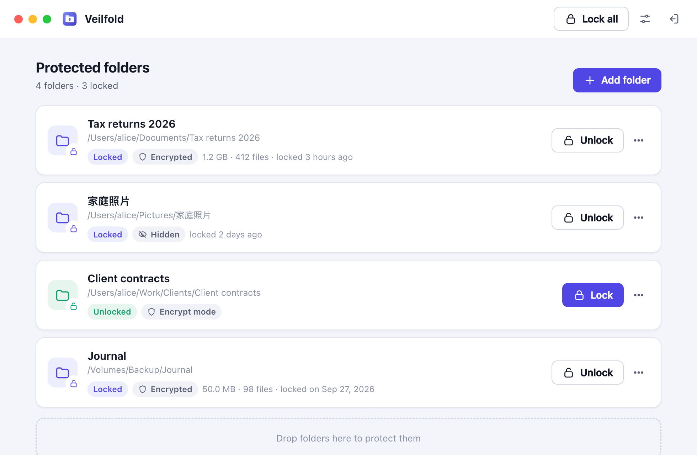
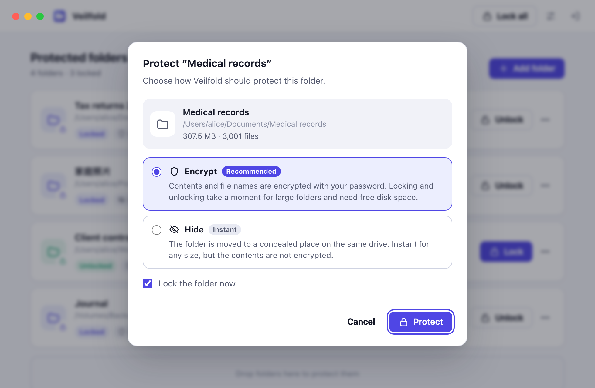

<p align="center">
  
</p>

<h1 align="center">Veilfold</h1>

<p align="center">
  <strong>在多人共用的电脑上，隐藏并锁定你的私密文件夹。</strong><br>
  加密或瞬间隐藏，由密码保护 —— 支持 macOS、Windows 和 Linux。
</p>

<p align="center">
  <a href="https://github.com/shenyizg/veilfold/actions/workflows/ci.yml"></a>
  <a href="https://github.com/shenyizg/veilfold/releases"></a>
  <a href="LICENSE"></a>
  
</p>

<p align="center">
  <a href="README.md">English</a> · <b>简体中文</b>
</p>

<p align="center">
  <picture>
    <source media="(prefers-color-scheme: dark)" srcset="docs/images/dark.png">
    
  </picture>
</p>

> 本文是 [README.md](README.md) 的中文翻译。如有出入，以英文版为准。

---

在家庭笔记本、办公室共用电脑或实验室机器上，任何坐下来的人都能浏览所有人的文件。
Veilfold 能让你选择的文件夹**从文件系统中原来的位置消失**，直到你用密码解锁为止。
它的理念类似 *Secret Folder*、*Folder Lock* 这类工具，但它免费、开源、跨平台，并且基于现代、可靠的密码学。

## 功能特点

- **两种保护模式，可按文件夹选择**
  - **加密（Encrypt）**：文件内容**和**文件名都会被加密成一个不透明的归档。没有密码谁也读不了，
    即使拥有管理员权限或者直接拿到硬盘也不行。
  - **隐藏（Hide）**：把文件夹瞬间移动到同一磁盘上的隐蔽存储区，与文件夹大小无关。
    适合体积巨大、只需防住"随手翻看"的文件夹。
- **真正消失，而不只是"隐藏属性"**：锁定后的文件夹在原位置已不存在，Finder、资源管理器、
  `ls -a`、`dir /a`、系统搜索和 Spotlight 都看不到它。
- **一台电脑，多人使用**：每个密码打开各自独立的保险库（vault），保险库之间互不可见；
  受保护文件夹的名称和位置本身也是加密存储的。
- **恢复密钥**：可选的、可打印的恢复密钥，忘记密码时可以用它找回访问权限。
- **设计上防崩溃**：每一步操作都先记录到加密索引中；锁定或解锁过程中如果被中断，
  下次打开保险库时会自动完成或回滚。只有在加密副本已写入、刷入磁盘并通过解密校验之后，才会删除明文。
- **macOS 和 Windows 提供桌面应用**，三大平台都提供可脚本化的**命令行工具**。
- **隐私优先**：无账号、不联网、无遥测，只有你的文件和你的密码。

<p align="center">
  
</p>

## 加密还是隐藏？

|                                        | 加密                                   | 隐藏                         |
| -------------------------------------- | -------------------------------------- | ---------------------------- |
| 锁定与解锁速度                         | 与文件夹大小成正比（SSD 上每秒数百 MB） | 瞬间完成，与大小无关         |
| 锁定时需要的额外磁盘空间               | 约等于文件夹大小                       | 不需要                       |
| 其他使用者浏览电脑时无法读取           | ✅                                     | ✅                           |
| 拥有管理员权限或物理接触硬盘时无法读取 | ✅                                     | ❌（只是隐藏，并未加密）     |
| 文件名不可见                           | ✅ 已加密                              | ✅ 以随机名称存放            |
| 元数据保留                             | 内容、名称、权限、时间、扩展属性       | 全部保留（只是一次移动）     |

敏感资料请用**加密**；对速度要求更高的大型媒体文件夹可以用**隐藏**。文件夹处于解锁状态时可以随时切换模式。

## 安装

### 下载发布版

从 [Releases 页面](https://github.com/shenyizg/veilfold/releases) 下载最新版本：

| 平台 | 桌面应用 | 命令行 |
| ---- | -------- | ------ |
| macOS 13+（Apple 芯片与 Intel） | `Veilfold_<版本>_macos_universal.zip` | `veilfold_<版本>_darwin_<架构>.tar.gz` |
| Windows 10/11（x64） | `Veilfold_<版本>_windows_amd64.zip` | `veilfold_<版本>_windows_<架构>.zip` |
| Linux（x64、arm64） | —（可从源码构建，实验性） | `veilfold_<版本>_linux_<架构>.tar.gz` |

> [!NOTE]
> 发布版暂未进行代码签名。macOS 首次打开时请右键点击 **Veilfold.app → 打开**；
> Windows 上在 SmartScreen 对话框中选择**更多信息 → 仍要运行**。

### 从源码构建

需要 [Go 1.26+](https://go.dev/dl/)。构建桌面应用时，macOS 还需要 Xcode 命令行工具（`xcode-select --install`），Windows 无需额外依赖。

```sh
git clone https://github.com/shenyizg/veilfold.git
cd veilfold
make build   # 命令行工具 -> bin/veilfold
make gui     # 桌面应用   -> gui/build/bin/
```

也可以只安装命令行工具：`go install github.com/shenyizg/veilfold/cmd/veilfold@latest`。
更多细节（包括 Linux 与交叉编译）见 [docs/building.md](docs/building.md)。

## 快速上手

### 桌面应用

1. 打开 Veilfold，设置一个密码，并妥善保存它显示的**恢复密钥**。
2. 点击 **Add folder**（或直接把文件夹拖进窗口），选择 **Encrypt** 或 **Hide**，然后点击 **Protect**。
3. 文件夹会从原位置消失。点击 **Unlock** 可以恢复它；离开电脑前点击 **Lock all**。也可以在设置中开启**自动锁定**。

### 命令行

```console
$ veilfold init                          # 创建你的保险库
$ veilfold add ~/Documents/Taxes         # 保护（并锁定）一个文件夹
Locked   /Users/alice/Documents/Taxes (encrypted, 412 files, 1.2 GB)
$ veilfold add --mode hide ~/Movies/Raw  # 对大文件夹使用瞬间隐藏
$ veilfold list
$ veilfold unlock taxes                  # 可用名称、路径或 ID 前缀指定
$ veilfold lock --all
```

全部命令见 [docs/cli.md](docs/cli.md)。在脚本中可使用 `--password-stdin` 从标准输入读取密码。

## 工作原理

- 每个保险库有一个随机生成的 256 位**主密钥**，它由你的密码经 **Argon2id**（64 MiB 内存、3 轮、4 并行）派生出的密钥加密包装，也可以额外由一个 128 位**恢复密钥**包装。
- 受保护文件夹的**索引**使用 **XChaCha20-Poly1305** 加密。
- 加密模式下，一个文件夹会成为一个归档，使用 **ChaCha20-Poly1305** 的 [STREAM](https://eprint.iacr.org/2015/189) 构造加密（64 KiB 分块，与 [age](https://age-encryption.org) 相同），因此截断、乱序和篡改都能被检测出来。
- 锁定的文件夹保存在同一磁盘上的**存储区**中：系统盘上位于 Veilfold 的数据目录内，其他磁盘上位于磁盘根目录下隐藏的 `.veilfold` 目录中。

详见 [docs/architecture.md](docs/architecture.md)、[docs/security-model.md](docs/security-model.md) 和 [docs/file-formats.md](docs/file-formats.md)（英文）。

## 安全模型概要

Veilfold 防护的是**使用同一台电脑的其他人**；在加密模式下，即使对方拥有管理员权限或能物理接触硬盘，也无法读取处于锁定状态的文件夹。

它**无法**防御运行在电脑上的恶意软件或键盘记录器、偷看你输入密码的人，也无法保护处于解锁状态的文件夹。已删除的明文可能残留在 SSD 以及日志型或写时复制文件系统上，因此建议同时启用全盘加密（FileVault、BitLocker、LUKS）。隐藏模式只是隐藏，并不加密。

发现安全漏洞？请私下报告，详见 [SECURITY.md](SECURITY.md)。

## 数据存放在哪里？

| | 数据目录（保险库与默认存储区） |
| --- | --- |
| macOS | `~/Library/Application Support/Veilfold` |
| Windows | `%LOCALAPPDATA%\Veilfold` |
| Linux | `$XDG_DATA_HOME/veilfold`（默认 `~/.local/share/veilfold`） |

其他磁盘上的文件夹保存在 `<磁盘根目录>/.veilfold/<用户>/`（macOS 上为 `.veilfold.noindex`），这样锁定时永远不需要跨磁盘复制数据。设置环境变量 `VEILFOLD_DATA_DIR` 或使用 `--data-dir` 可以指定其他数据目录，`veilfold info` 会打印当前使用的位置。

## 常见问题

<details>
<summary><b>忘记密码了，还能找回文件夹吗？</b></summary>

如果保存了恢复密钥，可以：在应用中点击 **Forgot password?**，或运行 `veilfold recover`。如果密码和恢复密钥都没有，任何人都无法恢复加密的文件夹 —— 这正是加密的意义。隐藏（未加密）的文件夹仍在存储区中，可以手动找到。
</details>

<details>
<summary><b>别人能看出我在用 Veilfold 吗？</b></summary>

别人能看到电脑上安装了 Veilfold，以及存在几个保险库；但无法知道某个保险库保护了哪些文件夹、它们叫什么、原来在哪里，加密的内容也无法读取。
</details>

<details>
<summary><b>锁定过程中电脑崩溃或断电怎么办？</b></summary>

不会丢失数据。每一步都会先记录再执行，只有在存在已校验的副本后才会删除原始数据。下次打开保险库时，Veilfold 会完成或撤销被中断的操作，并告诉你它做了什么。
</details>

<details>
<summary><b>能保护由 iCloud 云盘、OneDrive 或 Dropbox 同步的文件夹吗？</b></summary>

可以，但通常不建议：文件夹锁定期间，同步服务会认为它被删除了，并可能从你的其他设备上移除它。当文件夹看起来处于云同步目录中时，Veilfold 会给出提醒。
</details>

<details>
<summary><b>支持外接硬盘上的文件夹吗？</b></summary>

支持。Veilfold 会把锁定的数据保存在同一块磁盘上，因此解锁时需要连接该磁盘。
</details>

## 许可证

Veilfold 以 [MIT 许可证](LICENSE) 发布。
