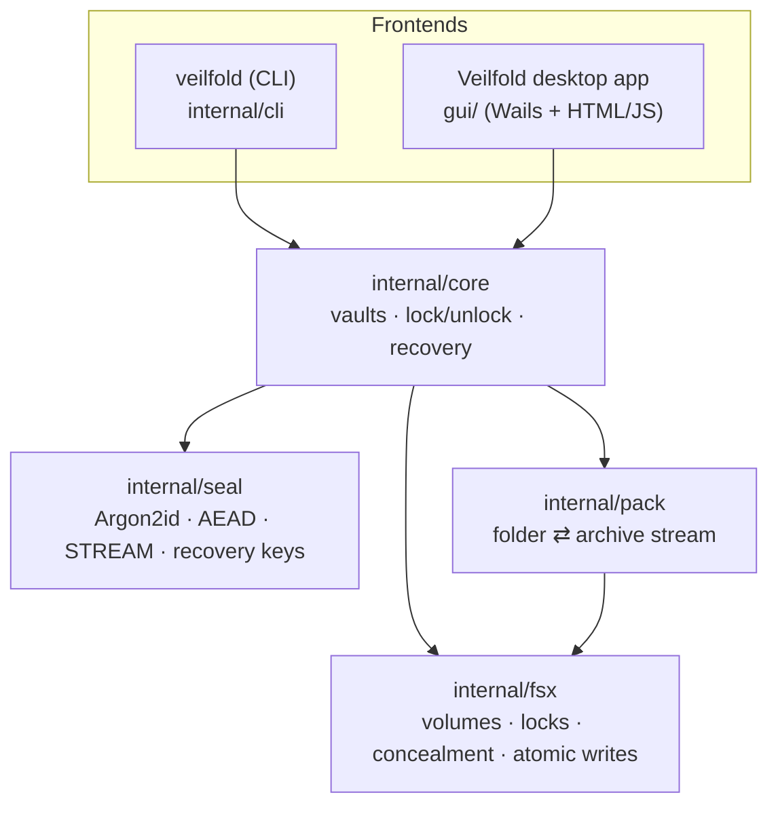
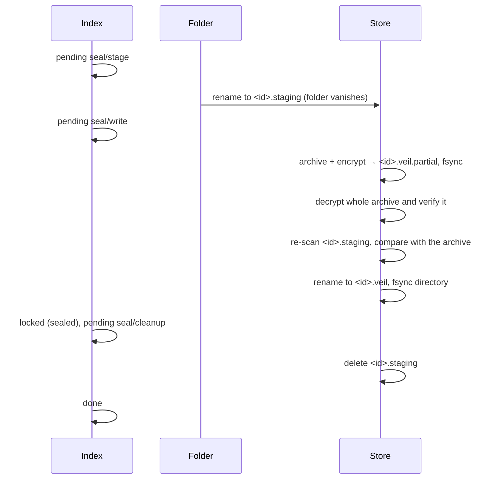

# Architecture

This document describes how Veilfold is put together and how it keeps data safe while moving it around.
For the cryptographic design and threat model see [security-model.md](security-model.md); for byte-level
layouts see [file-formats.md](file-formats.md).

## Components



| Package | Responsibility |
| --- | --- |
| `internal/seal` | Cryptographic building blocks: Argon2id, HKDF-SHA256 sub keys, XChaCha20-Poly1305 for small messages, ChaCha20-Poly1305 STREAM for large data, recovery key encoding. |
| `internal/pack` | Serializes a folder tree (directories, files, Unix symlinks, permissions, times, extended attributes, Windows attributes) into one sequential stream and back, rejecting anything unsafe on extraction. |
| `internal/fsx` | Platform layer: volume identity and mount points, free space, advisory file locks, durable/atomic writes, concealment attributes, opening Finder/Explorer. |
| `internal/core` | The engine: data directory, vaults, the encrypted index, protecting/locking/unlocking folders, path validation, crash recovery. |
| `internal/cli` | The `veilfold` command. |
| `gui/` | The desktop app. A separate Go module so that the CLI's dependency tree stays minimal (Go standard library plus `golang.org/x/crypto`, `x/sys` and `x/term`). |

Both frontends use the same `core.Service` / `core.Session` API, so the CLI and the desktop app behave
identically and can be used side by side.

## Concepts

**Data directory** — per operating-system user (see the README for locations). It holds the vaults,
the default store and a lock file.

**Vault** — a password-protected container with a random 256-bit master key and an encrypted *index*
of protected folders. A data directory can hold several vaults. A vault has no name: the password alone
selects it. Opening tries the password against every vault header (in parallel); creating or changing
a password is refused if another vault already uses it.

**Item** — a protected folder. It has an *ID* (128 random bits), a *path* (where it lives when
unlocked), a *mode* (`encrypt` or `hide`, applied the next time it is locked) and, when locked,
a *storage* (`sealed` = encrypted archive, `hidden` = concealed folder) in a *store*.

**Store** — a directory on the same drive as the item that holds locked data. Using the same drive
means locking never copies data between drives and hide mode is a single atomic rename. Stores are
chosen in this order:

1. `<data dir>/store` (`store.noindex` on macOS) if the folder is on the same drive as the data directory;
2. `<drive root>/.veilfold/<user tag>/` (`.veilfold.noindex` on macOS) for other drives;
3. `<parent folder>/.veilfold/<user tag>/` as a last resort (for example when the drive root is not
   writable, or a rename fails with `EXDEV` on Linux bind mounts).

The user tag is a hash of the account's UID (Unix) or SID (Windows), so several accounts can share an
external drive. Store directories are created with mode `0700`, marked hidden (Finder flag on macOS,
hidden + system attributes on Windows) and, on macOS, named `.noindex` so Spotlight skips them.

## On-disk layout

```text
<data dir>/
├── veilfold.lock                  advisory lock serializing all changes
├── gui-settings.json              desktop app preferences (not secret)
├── vaults/
│   └── <vault id>/
│       ├── vault.json             key slots (password, recovery key) – no metadata
│       ├── index.vfi              encrypted index of protected folders
│       └── index.vfi.bak          backup copy of the index (written first)
└── store/                         (store.noindex on macOS)
    ├── <item id>                  a hidden folder (hide mode), permissions removed
    ├── <item id>.veil             an encrypted folder (encrypt mode)
    ├── <item id>.veil.partial     transient: archive being written
    └── <item id>.staging          transient: folder being encrypted

<other drive>/.veilfold/<user tag>/ the same store layout on other drives
<parent>/.veilfold-<id>.restore     transient: folder being decrypted next to its destination
```

The store is shared by all vaults of the data directory; entries are named by random IDs only, so the
store does not reveal which vault an entry belongs to, nor its name or original location.

## Operations and their phases

Every operation that touches user data is a sequence of steps. Before each step the core records the
step it is about to take (`pending.phase` in the encrypted index, written atomically). If the process
dies, the next `Open` of the vault inspects the recorded phase and the file system and either finishes
or undoes the operation (`repairRecord` in `internal/core/repair.go`).

The rule that governs every step and every repair: **data is only ever deleted when another complete,
verified copy is known to exist.** When the state is ambiguous, Veilfold keeps both copies.

If a repair cannot finish (for example because a file is in use, or the folder's original location has
disappeared), the pending record is kept and every further lock, unlock or remove of that folder is
refused with a message that says where its data is, so that nothing can overwrite that knowledge. The
repair is retried each time the vault is opened, and the folder can always be restored to another
location (`veilfold unlock --to`, or **Restore to another location…** in the app).

When a vault is opened, Veilfold also looks for data the index does not account for — for example an
unencrypted staging folder of a folder that is recorded as unlocked — and reports it. It deletes nothing
it finds except incomplete encrypted archives (`*.veil.partial`), which never hold the only copy of
anything.

All changes are serialized by an exclusive advisory lock on `veilfold.lock` (`flock` on Unix,
`LockFileEx` on Windows), which the operating system releases if the process dies. A second process
gets a "busy" error instead of interleaving.

### Hide (lock in hide mode)

| Phase recorded | Step | Repair if interrupted |
| --- | --- | --- |
| `hide/move` | rename `<path>` → `<store>/<id>`, then conceal it (Unix: `chmod 000`; Windows: hidden + system + not-indexed attributes) | if `<store>/<id>` exists: conceal it and mark the item locked; otherwise nothing happened |

The folder's original permission bits (Unix) or attributes (Windows) are recorded *before* concealing so
that they can always be restored.

### Unhide (unlock in hide mode)

| Phase recorded | Step | Repair if interrupted |
| --- | --- | --- |
| `unhide/move` | reveal `<store>/<id>`, rename it → destination | if `<store>/<id>` still exists: conceal it again (still locked); else if the destination exists: mark unlocked |

A hidden folder can only be restored on the drive it was hidden on, because restoring is a rename.

### Encrypt (lock in encrypt mode)



| Phase recorded | Steps | Repair if interrupted |
| --- | --- | --- |
| `seal/stage` | rename the folder into the store as `<id>.staging` | put the staging folder back (see below) |
| `seal/write` | write, flush and verify `<id>.veil.partial`; re-scan the staging folder and compare its fingerprint with the archive; rename to `<id>.veil` | if `<id>.veil` exists it was verified and compared: finish the lock; otherwise put the staging folder back |
| `seal/abort` | recorded as soon as a lock fails, before undoing it | put the staging folder back — never finish the lock |
| `seal/cleanup` | delete `<id>.staging` | only if the item is recorded as sealed and `<id>.veil` exists: delete it again; otherwise put the staging folder back |

Moving the folder out of its location *first* means the snapshot that gets encrypted is consistent
(no program can open new files in it by path) and the folder disappears immediately. On Windows the
rename fails if a program has files in the folder open, before anything else happens.

"Put the staging folder back" renames it to its original location. If something else was created at
that location in the meantime, the folder is instead kept as a *hidden* item in the store
(storage `hidden`), so no data is ever overwritten; the user can unlock it to another location. The
encrypted copy is deleted only after the staging folder is safely in its place.

Before encrypting, Veilfold scans the folder (size; unsupported entries such as sockets or — on
Windows — junctions and cloud placeholders; other file systems mounted inside it) and checks free space.
While archiving it refuses files that change size or modification time during the read. Programs that
still have files open, or a working directory inside the folder, can keep writing after a file was read;
that is why the staging folder is scanned again and its fingerprint (names, types, permissions, sizes,
times and link targets of every entry) is compared with the archive's before the archive is accepted.
Any difference aborts the lock and puts the folder back with the changes.

### Decrypt (unlock in encrypt mode)

| Phase recorded | Steps | Repair if interrupted |
| --- | --- | --- |
| `unseal/extract` | decrypt and extract into `<parent>/.veilfold-<id>.restore` (each file fsynced), write a marker file `.veilfold-<id>.restoring` inside it | delete the partial restore; still locked (the record is kept until the deletion succeeds) |
| `unseal/rename` | rename the restore folder → destination | if the restore folder still exists: delete it (still locked). If the destination contains the marker: finish the unlock. Otherwise the destination cannot be proven to be ours: keep the archive, still locked |
| `unseal/cleanup` | remove the marker, apply the root folder's metadata, full flush (`F_FULLFSYNC` on macOS), delete `<id>.veil` | repeat these steps |

The root folder's own metadata (mode, times, extended attributes) is stored in the pending record so it
can be applied after the marker is removed, even across a crash.

### Remove and forget

*Remove* unlocks a locked item (to its original location) and deletes it from the index. *Forget* drops
a locked item whose data no longer exists (for example on an erased drive); it refuses if the data is
still present.

## Validation

Before a folder is protected (and again before each lock), the core checks that it:

- exists, is a real directory (not a symbolic link, junction or file) and is not the root of a drive;
- is not, and does not contain, the home directory, the Veilfold data directory or the directory of the
  running executable;
- is not inside operating-system or program directories (for example `/System`, `/usr`,
  `C:\Windows`, `C:\Program Files`) and is not a shared container such as `/Users` or `C:\Users`;
- does not belong to, or directly contain, a Veilfold store;
- does not overlap (contain or sit inside) another folder protected by the same vault.

Store directories themselves are only used if they are real directories (not links) owned by the
current user with mode `0700`; the shared `.veilfold` directory on other drives must have the sticky bit
if someone else owns it. Deleting staging folders never descends into other mounted file systems.

Comparisons are case-insensitive on macOS and Windows and follow symbolic links in parent directories.
Advisory warnings are produced for folders inside cloud-synced directories and for very large folders
in encrypt mode.

## The index

The index is a JSON document (`{version, items: [...]}`) encrypted as a whole. Each save writes the new
version atomically (temporary file, `fsync`, rename, directory `fsync`) first to `index.vfi.bak` and then
to `index.vfi`; a save only counts as done when both succeeded. The backup is therefore never older than
the index. If the index cannot be read, the backup is used: it describes either the same state or the
state just before the step that was about to run, and both are consistent with the files on disk because
no step runs before its save has succeeded.

On Windows, renames and reads of the index are retried for a moment when another process (often an
antivirus scanner) briefly holds the file open.

## Desktop app

The desktop app is a [Wails v2](https://wails.io) application: a Go backend (`gui/app.go`) bound to a
plain HTML/CSS/JavaScript frontend (`gui/frontend/dist`) rendered by the system web view (WKWebView on
macOS, WebView2 on Windows). There is no JavaScript build step.

- Operations run one at a time on a background goroutine; progress is streamed to the UI as events
  (`op:start`, `op:progress`, `op:end`) and can be cancelled, which rolls the operation back.
- Closing the window or quitting while folders are unlocked asks whether to lock them first; quitting
  during an operation is refused.
- Optional auto-lock locks every folder and closes the vault after a period of inactivity.
- Errors cross the bridge as JSON with a machine-readable `code`, so the UI can offer the right next
  step (for example "Unlock to another location…" when the original location is taken).

## Testing

- `internal/seal`: round trips at chunk boundaries; detection of truncation, reordering, extension, bit
  flips, wrong keys and wrong associated data; recovery key parsing and checksum.
- `internal/pack`: full-fidelity round trip (permissions, times, extended attributes, symlinks, Unicode
  names, read-only directories); malformed archives; path traversal and symlink-redirection attempts.
- `internal/core`: vault life cycle, isolation between vaults, both modes, unlocking elsewhere,
  protection rules, cancellation, index backup, and **crash simulation**: a test hook panics at each of
  the 13 critical points of every operation, the vault is reopened, and the tests assert that no
  operation is left pending, the data is byte-for-byte identical and no stray files remain.
- `internal/fsx`: atomic writes, removal of read-only trees, advisory locks, volume detection and
  concealment, exercised natively on each platform.
- `internal/cli`: end-to-end command workflows in-process.
- `gui`: the desktop app's real frontend runs in headless Chrome against the real backend, and a script
  clicks through every flow the way a user would: creating a vault, protecting in both modes, locking,
  unlocking, changing the password, recovering with the recovery key, restoring to another location,
  and cancelling a lock half-way. Each click is hit-tested, so covered controls fail the test. After
  every step that touches files, the test checks on disk that the folders are byte-for-byte intact,
  that encrypted folders are not readable anywhere, and that no stray files remain.

In addition, failure-injection tests cover saves that fail mid-operation, clean-ups that cannot delete,
original locations that disappear during a lock, files that change while being locked, replaced
archives, leftover data, planted store directories and mount points inside folders.

CI runs the suite on Linux, macOS and Windows.
